# Отчёт по практическому занятию №19: SEO и аналитика (проверка метатегов, sitemap, Lighthouse, Core Web Vitals)

* **Студент:** Гусенков Данил Дмитриевич
* **Группа:** ПР-25.106
* **Вариант / Проект:** FoodHub — Маркетплейс доставки еды и групповых заказов
* **Проверяемый адрес:** `https://foodhub.localhost`

---

## 1. Результаты замеров Lighthouse (до исправлений)

Замеры проводились в режиме Инкогнито браузера Google Chrome (`Mode: Navigation`, `Device: Desktop`, все 4 категории) по 3 запуска подряд для определения медианных значений.

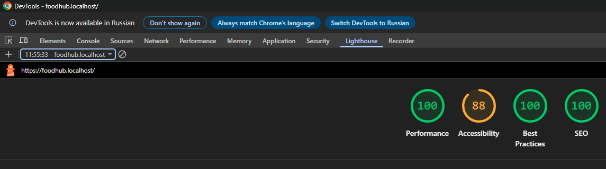
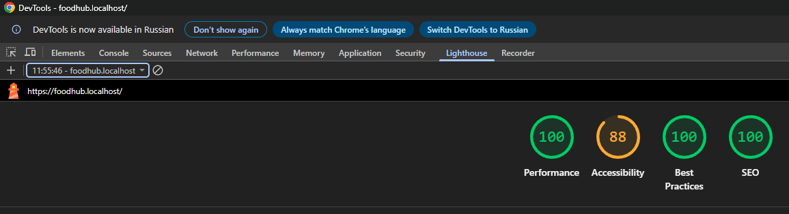
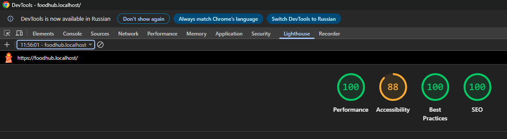

### Таблица 1. Итоговые оценки по категориям (3 запуска)

| Страница | Категория | Запуск 1 | Запуск 2 | Запуск 3 | Медиана |
| :--- | :--- | :---: | :---: | :---: | :---: |
| `/` (Главная) | **Performance** | 100 | 100 | 100 | **100** |
| `/` (Главная) | **Accessibility** | 88 | 88 | 88 | **88** |
| `/` (Главная) | **Best Practices** | 100 | 100 | 100 | **100** |
| `/` (Главная) | **SEO** | 100 | 100 | 100 | **100** |

### Таблица 2. Метрики производительности медианного запуска

| Страница | FCP | LCP | TBT | CLS | Speed Index |
| :--- | :---: | :---: | :---: | :---: | :---: |
| `/` (Главная) | 0,3 с | 0,3 с | 0 мс | 0,003 | 0,3 с |

Сохранённый HTML-отчёт медианного запуска приложен в файле: [`reports/home.html`](reports/home.html).

---

## 2. Живые метрики Core Web Vitals (вкладка Performance)

Проверка проводилась в реальном времени при загрузке страницы и взаимодействии с конструктором блюд (переключение чекбоксов модификаторов и нажатие кнопки «В корзину»).

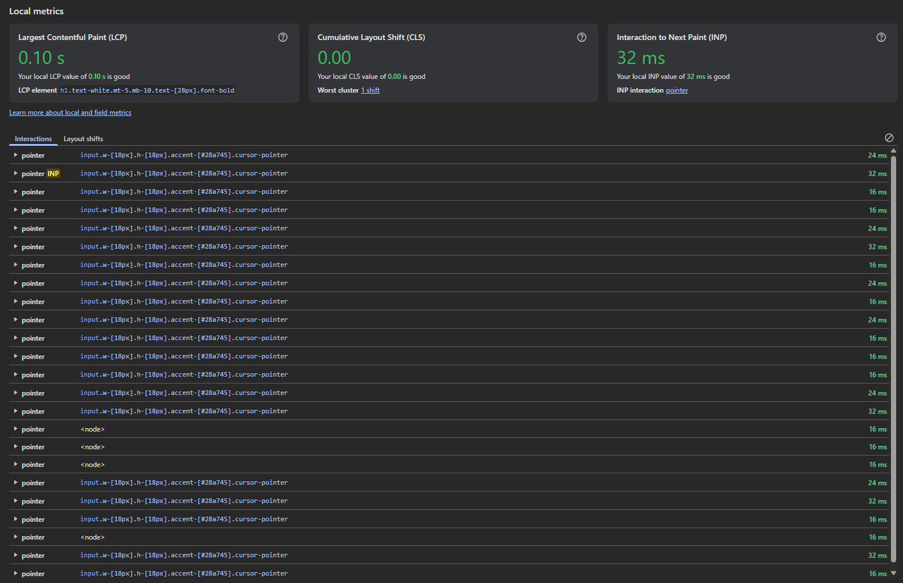
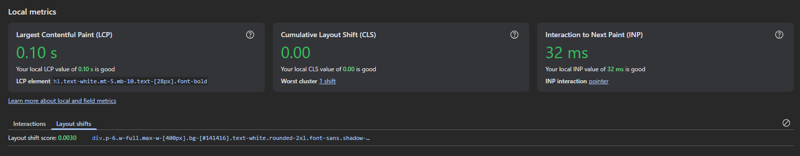

### Таблица 3. Показатели Core Web Vitals в локальной сессии

| Метрика | Значение | Статус | Комментарий |
| :--- | :---: | :---: | :--- |
| **LCP** (Largest Contentful Paint) | `0.10 s` | Хорошо (`≤ 2.5 s`) | Главный элемент отрисовки — заголовок `<h1>` («Оформление заказа в FoodHub») |
| **CLS** (Cumulative Layout Shift) | `0.00` (`0.0030`) | Хорошо (`≤ 0.1`) | Небольшой сдвиг `0.0030` возникал при замене строки загрузки на карточку блюда после ответа API |
| **INP** (Interaction to Next Paint) | `32 ms` | Хорошо (`≤ 200 ms`) | Самое долгое взаимодействие — клик по чекбоксу модификатора (`input[type="checkbox"]`), выполняется мгновенно |

---

## 3. Ручные проверки (HTML, индексация, клавиатура)

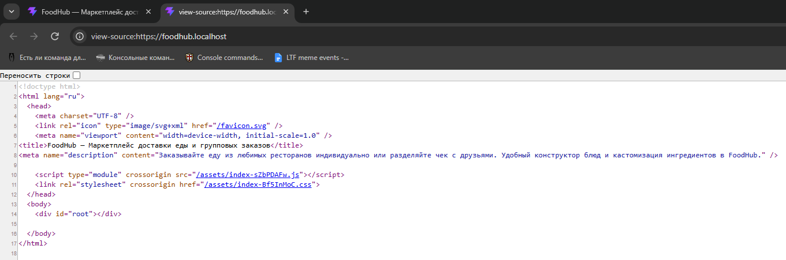
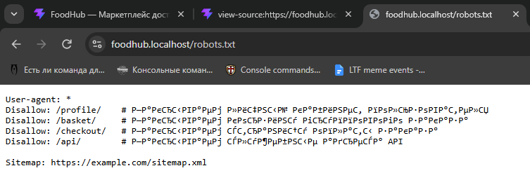
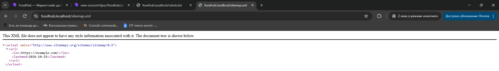
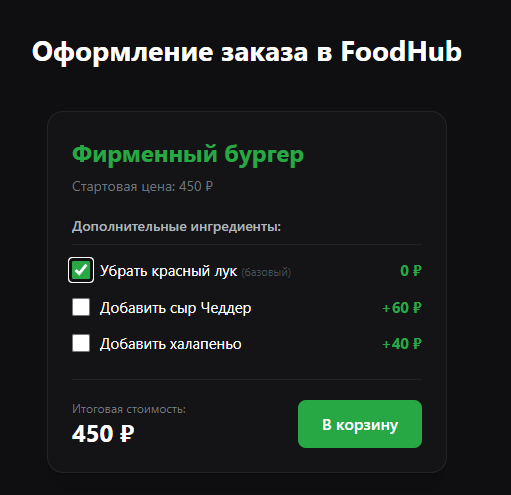

### Таблица 4. Результаты ручных проверок

| Проверка | Страница | Результат | Комментарий |
| :--- | :---: | :---: | :--- |
| Атрибут `lang` у `<html>` | `/` | Есть | Указан `lang="ru"` |
| Тег `<title>` | `/` | Есть | «FoodHub — Маркетплейс доставки еды и групповых заказов» |
| Метатег `description` | `/` | Есть | Содержательное описание функционала сервиса (139 символов) |
| Содержимое в исходном HTML | `/` | Нет (CSR) | В исходном HTML находится `

`; карточка блюда и модификаторы загружаются на клиенте после выполнения JS и запроса к `/api/dish/1/modifiers` |
| Атрибут `alt` у картинок | `/` | Не применимо | На текущей странице в конструкторе блюд отсутствуют теги `` |
| Метатег / заголовок `noindex` | `/api/*` | Есть (в заголовке) | Для всех ответов API настроен HTTP-заголовок `X-Robots-Tag: noindex, nofollow` в `nginx` и `Program.cs` |
| Файл `robots.txt` | `/robots.txt` | Есть (с замечанием) | Открывается как текст, закрыты `/profile/`, `/basket/`, `/checkout/`, `/api/`, но кириллические комментарии отображались некорректно без `charset=utf-8` |
| Файл `sitemap.xml` | `/sitemap.xml` | Есть | Валидный XML, главная страница не закрыта в `robots.txt` |
| Навигация с клавиатуры | `/` | Есть | Клавишей `Tab` фокус последовательно проходит по всем чекбоксам модификаторов и кнопке «В корзину», элементы управляются с клавиатуры |

---

## 4. Сравнение с сайтом-аналогом

Для сравнения был выбран крупный действующий сервис доставки еды — **Додо Пицца** (`https://dodopizza.ru/`). Анализ проведён через **PageSpeed Insights** (вкладка «Мобильные устройства», данные по источнику за последние 28 дней).

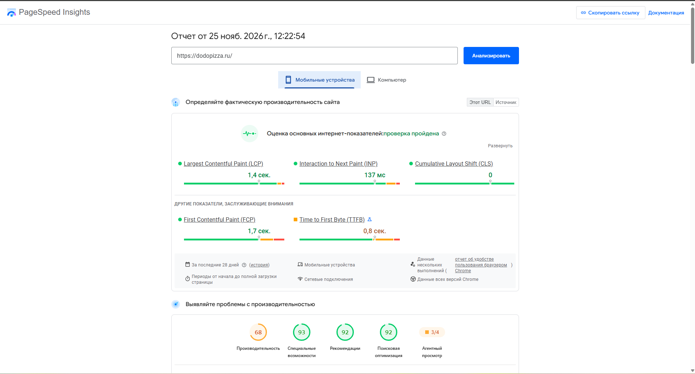
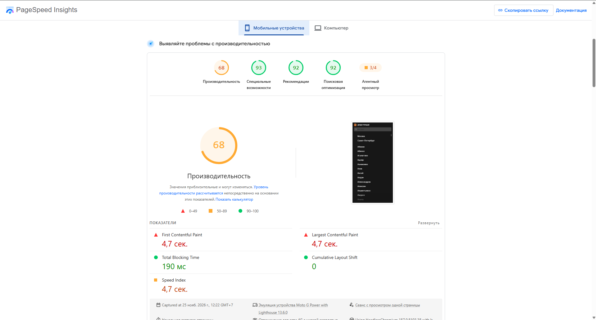

### Таблица 5. Сравнительная таблица показателей

| Показатель | Наш проект FoodHub (лабораторные данные, Desktop) | Сайт-аналог `dodopizza.ru`: полевые данные (мобильные) | Сайт-аналог `dodopizza.ru`: Lighthouse (мобильные) |
| :--- | :---: | :---: | :---: |
| **LCP** | `0,3 с` (`0,10 с` live) | `1,4 с` (хорошо) | `4,7 с` |
| **INP** | `32 мс` (live) | `137 мс` (хорошо) | — |
| **CLS** | `0` (после правки) | `0` (хорошо) | `0` |
| **Performance** | `100` | — | `68` |
| **Accessibility** | `91` (после правки) | — | `93` |
| **Best Practices** | `100` | — | `92` |
| **SEO** | `100` | — | `92` |

### Выводы по результатам сравнения

1. **Визуальная стабильность (CLS):** у сайта-аналога `dodopizza.ru` сдвиг макета полностью отсутствует (`CLS = 0`) как в полевых, так и в лабораторных данных за счёт предварительного резервирования места под блоки. В `FoodHub` после добавления минимальной высоты блока конструктора удалось добиться аналогичного нулевого сдвига (`CLS = 0`).
2. **Различие лабораторных и полевых данных (CrUX):** у `dodopizza.ru` в мобильном Lighthouse `Performance = 68` и `LCP = 4,7 с` из-за эмуляции слабого устройства и мобильной сети, однако в полевых данных реальных пользователей проверка Core Web Vitals успешно пройдена (`LCP = 1,4 с`, `INP = 137 мс`, `CLS = 0`).
3. **Отсутствие полевых данных для локального стенда:** для `FoodHub` полевые данные CrUX недоступны, так как приложение развёрнуто локально (`https://foodhub.localhost`) и не имеет реального пользовательского трафика из Интернета.

---

## 5. Приоритизация найденных проблем и результаты исправления («Было — Стало»)

### Таблица 6. Приоритизация выявленных недочётов

| № | Проблема | Где найдена | Влияние | Сложность | Приоритет | Статус |
| :-: | :--- | :--- | :---: | :---: | :---: | :---: |
| 1 | Нарушение иерархии заголовков (`<h1>` → `<h2>` → `<h4>`, пропущен `<h3>`) и низкий контраст второстепенного текста (`#495057` / `#6c757d`) на тёмном фоне | `DishConstructor.tsx` (Lighthouse Accessibility: 88) | Высокое | Низкая | **1 (Высокий)** | **Исправлено** |
| 2 | Небольшой сдвиг макета (`CLS = 0.003`) при замене текста загрузки на карточку блюда после ответа API | `DishConstructor.tsx` (Performance / Lighthouse) | Среднее | Низкая | **2 (Высокий)** | **Исправлено** |
| 3 | Некорректное отображение кириллических комментариев в `robots.txt` из-за отсутствия `charset=utf-8` и учебный домен `example.com` | `public/robots.txt` (ручная проверка) | Среднее | Низкая | **3 (Средний)** | **Исправлено** |
| 4 | Клиентский рендеринг (CSR): карточка блюда отсутствует в исходном HTML до выполнения JS | `index.html` / SPA-архитектура (ручная проверка `view-source`) | Среднее | Высокая | **4 (Низкий / на будущее)** | Отложено (требует перехода на SSR) |

### Что было исправлено

1. **Доступность и иерархия заголовков (`DishConstructor.tsx`):** тег `<h4>` («Дополнительные ингредиенты:») заменён на `<h3>`, итоговая стоимость переведена из заголовка `<h3>` в параграф `
`, а тусклые серые оттенки заменены на более контрастный `text-zinc-400`.
2. **Устранение сдвига макета (`DishConstructor.tsx`):** для контейнера загрузки и основной карточки задана единая минимальная высота `min-h-[345px]`, благодаря чему макет не смещается после получения данных из PostgreSQL (Supabase).
3. **Кодировка и адрес в `robots.txt`:** удалены кириллические комментарии, вызывавшие искажение кодировки при отдаче файла через `nginx`, и обновлён путь `Sitemap` на `https://foodhub.localhost/sitemap.xml`.

### Сравнение показателей «Было — Стало»

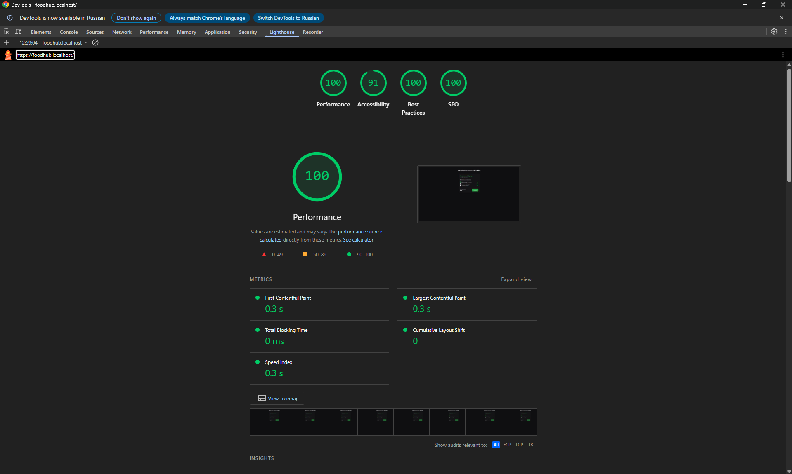

| Показатель | Было | Стало | Изменение |
| :--- | :---: | :---: | :---: |
| **Accessibility (Lighthouse)** | `88` (оранжевая зона) | **`91`** (зелёная зона) | **+3 балла** (выход в зелёную зону) |
| **CLS (Cumulative Layout Shift)** | `0.003` | **`0`** | **Полностью устранён сдвиг макета** |
| **Performance / Best Practices / SEO** | `100 / 100 / 100` | **`100 / 100 / 100`** | Сохранены максимальные оценки |
