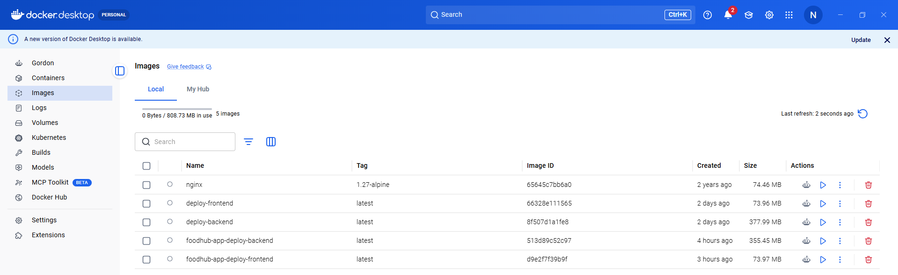
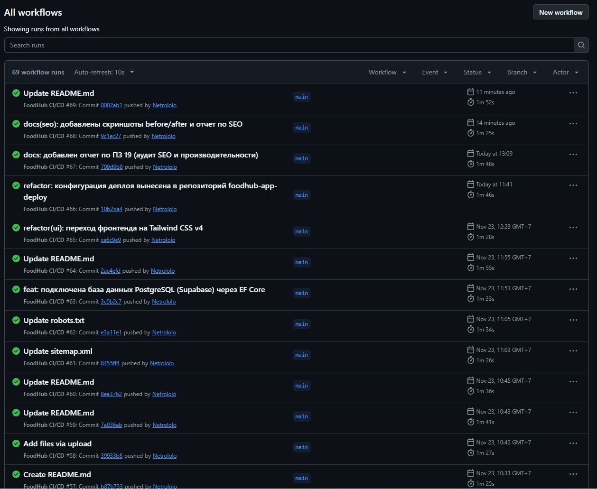
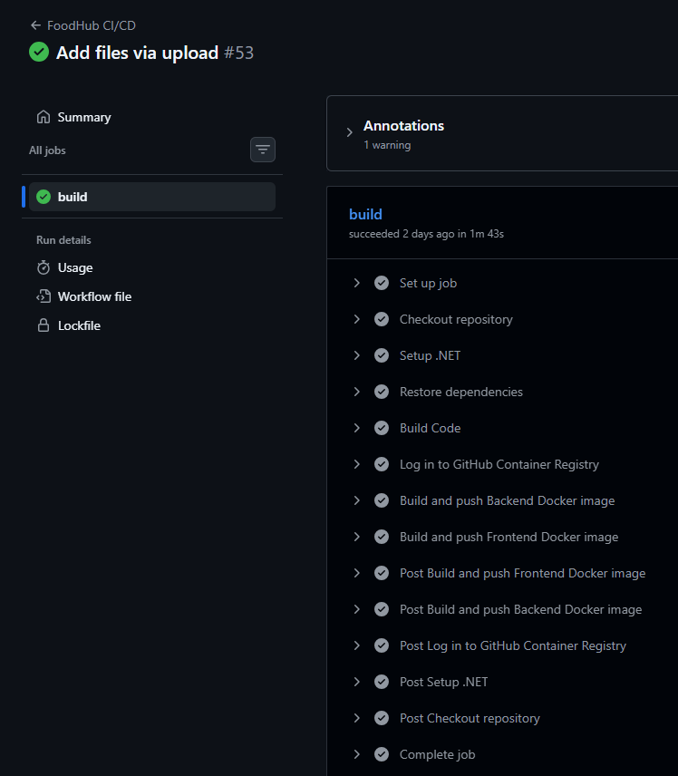
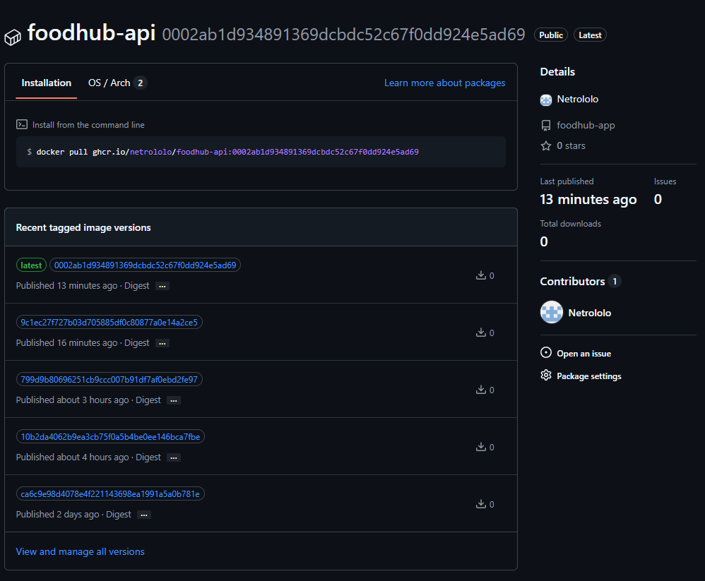
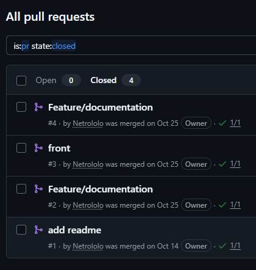
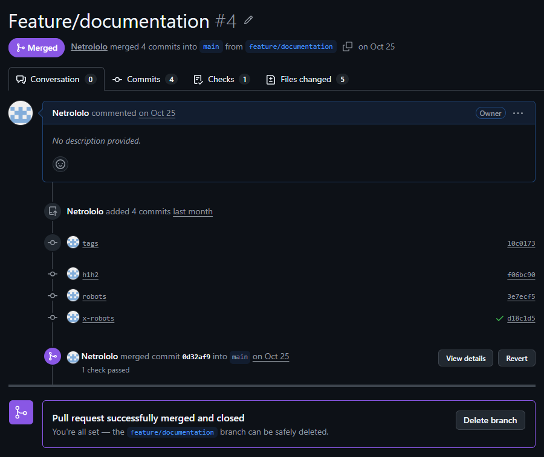

# Отчёт по практическому занятию №15: Автоматизация сборки и деплоя проекта через GitHub Actions и Docker

* **Студент:** Гусенков Данил Дмитриевич
* **Группа:** ПР-25.106
* **Проект:** FoodHub — Маркетплейс доставки еды и групповых заказов
* **Публичный репозиторий:** https://github.com/Netrololo/foodhub-app

---

## 1. Контейнеризация приложения (Docker)

Для обоих сервисов проекта настроены многоэтапные `Dockerfile` и файлы `.dockerignore`:

* **Бэкенд (`FoodHubApi/Dockerfile`):**
  * Этап `build` на базе `://microsoft.com` выполняет восстановление зависимостей (`dotnet restore`) и публикацию релизной сборки (`dotnet publish -c Release`).
  * Финальный образ на базе `://microsoft.com` запускает приложение от непривилегированного пользователя (`USER app`) на порту `8080`.
  * В `FoodHubApi/.dockerignore` исключены каталоги `bin/`, `obj/`, настройки IDE (`.vs/`, `.vscode/`), `.git/` и локальные конфигурации.
* **Фронтенд (`FoodHubClient/Dockerfile`):**
  * Этап `build` на базе `node:22-alpine` устанавливает пакеты (`npm ci`) и собирает оптимизированный бандл Vite с аргументом `VITE_API_URL=/api`.
  * Финальный образ на базе `nginx:1.27-alpine` раздаёт статические файлы из `/usr/share/nginx/html` с поддержкой SPA-маршрутизации (`try_files $uri $uri/ /index.html;`) на порту `80`.
  * В `FoodHubClient/.dockerignore` исключены `node_modules`, `dist`, `.git` и `.env`.

### Проверка работы Docker локально


---

## 2. Настройка CI/CD в GitHub Actions и публикация в GHCR

В каталоге `.github/workflows/main.yml` создан сценарий **`FoodHub CI/CD`**, который автоматически запускается при событиях `push` и `pull_request` в ветки `main`/`master`, а также вручную через `workflow_dispatch`.

### Основные этапы пайплайна:
1. **Checkout repository (`actions/checkout@v4`):** клонирование исходного кода репозитория на раннер `ubuntu-latest`.
2. **Setup .NET, Restore & Build:** установка .NET SDK 10.0, восстановление пакетов и тестовая сборка `FoodHubApi` в конфигурации `Release`.
3. **Log in to GitHub Container Registry (`docker/login-action@v3`):** авторизация в реестре `ghcr.io` с использованием автоматического токена `${{ secrets.GITHUB_TOKEN }}`.
4. **Build and push Docker images (`docker/build-push-action@v5`):** сборка Docker-образов для `FoodHubApi` и `FoodHubClient` и их публикация в GHCR (при отправке в основную ветку) сразу с двумя тегами:
   * `:latest` — актуальная сборка;
   * `:${{ github.sha }}` — сборка с привязкой к конкретному хэшу коммита.

### Результаты выполнения GitHub Actions и реестр образов (GHCR)




---

## 3. Работа с Pull Requests (PR)

**Pull Request (запрос на слияние)** — это механизм GitHub, позволяющий предложить изменения из отдельной рабочей ветки в основную ветку репозитория (`main`), провести ревью кода и автоматически запустить проверки CI перед слиянием.

### Пошаговый алгоритм и команды Git при работе с PR:
1. **Создание и переход на новую рабочую ветку из актуальной `main`:**
   ```bash
   git checkout main
   git pull origin main
   git checkout -b feature/documentation
   ```
2. **Внесение изменений в код/документацию, индексация и коммит:**
   ```bash
   git add .
   git commit -m "docs: добавлена документация проекта"
   ```
3. **Отправка новой ветки в удалённый репозиторий на GitHub:**
   ```bash
   git push -u origin feature/documentation
   ```
4. **Создание и слияние Pull Request в веб-интерфейсе GitHub:**
   * В репозитории на GitHub нажать **Compare & pull request** (или перейти во вкладку **Pull requests → New pull request**).
   * Выбрать базовую ветку (`base: main`) и ветку с изменениями (`compare: feature/documentation`), заполнить заголовок и описание, нажать **Create pull request**.
   * Дождаться успешного прохождения автоматической проверки **GitHub Actions** (`FoodHub CI/CD`), после чего нажать **Merge pull request** → **Confirm merge** и удалить временную ветку.

### Скриншоты работы с Pull Requests в репозитории


